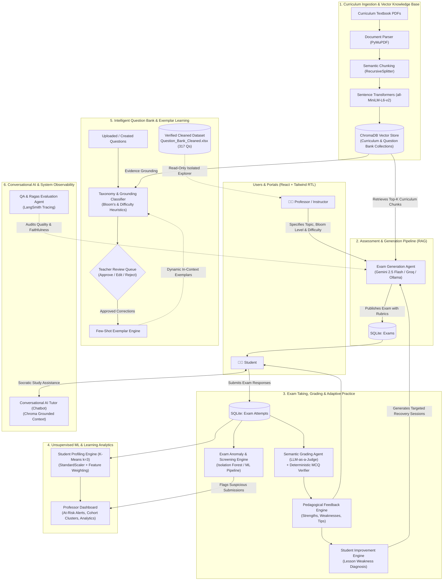

# Intelligent Educational Assessment System

An AI-powered assessment, grading, and diagnostic platform that generates curriculum-grounded exams, grades open-ended essays semantically, clusters student learning behaviors, detects exam anomalies, provides personalized improvement recommendations, and maintains an intelligent, human-verified Question Bank.

> **Status:** Production-Ready Graduation Project. Fully implemented, hardened, and verified end-to-end with **284 automated tests (100% pass rate)**.

---

## System Architecture



---

## Core System Modules & Features

| # | Feature / Subsystem | Technology Stack | Description | Status |
|---|---|---|---|---|
| **1** | **Curriculum Ingestion & RAG** | LangChain, PyMuPDF, `all-MiniLM-L6-v2`, ChromaDB | Ingests textbook PDFs, performs semantic text chunking, builds dense vector embeddings, and indexes them with lesson metadata. | **Production-Ready** |
| **2** | **Exam & Question Generation** | Google Gemini, Groq (Llama-3.3-70B), Ollama | Generates curriculum-grounded MCQs (with 4 distinct distractors) and essay questions across Bloom's Taxonomy cognitive tiers with strict JSON schemas. | **Production-Ready** |
| **3** | **Semantic Grading (LLM-as-a-Judge)** | Multi-Criterion Prompting, NLP | Scores open-ended student answers across Accuracy, Completeness, Clarity, and Reasoning with partial credit and justified score deductions. | **Production-Ready** |
| **4** | **Student Improvement Engine** | Longitudinal Diagnostics, Adaptive RAG | Tracks error patterns per lesson (*Weak, Developing, Strong*), generates calibrated practice exams on weak topics, and measures score progression. | **Production-Ready** |
| **5** | **Student Profiling & Analytics** | Scikit-Learn (`KMeans`, `StandardScaler`) | Segments students into performance tiers (*Needs Intervention, Proficient, Advanced*) and alerts teachers about at-risk students. | **Production-Ready** |
| **6** | **Exam Anomaly & Screening** | Scikit-Learn Anomaly Pipeline, MLflow | Screens exam completion durations, score deviations, and submission behaviors to flag suspicious exam attempts for instructor review. | **Production-Ready** |
| **7** | **Intelligent Question Bank** | In-Context Learning, Few-Shot Exemplars | Classifies questions into Bloom's levels and difficulty, calculates grounding confidence, and learns from instructor approvals and edits. | **Production-Ready** |
| **8** | **Cleaned Dataset Explorer** | Pandas, Cryptographic Provenance | Provides a safe, isolated, read-only interface for 317 verified curriculum questions (`Question_Bank_Cleaned.xlsx`) with SHA-256 integrity. | **Production-Ready** |
| **9** | **Conversational AI Tutor** | LangChain, ChromaDB, Socratic Prompting | Interactive chatbot assisting students with course material, answering queries strictly using textbook passages without leaking exam answers. | **Production-Ready** |
| **10** | **RAG Evaluation & Observability** | Ragas v0.4.3, LangSmith, Matplotlib | Measures Faithfulness, Context Precision, Context Recall, and Answer Relevancy, generating trace trees and visual metric plots. | **Production-Ready** |

---

## Verified Evaluation Metrics

### 1. Ragas RAG Benchmark Results
Evaluated on [`data/evaluation/rag_test_set.json`](file:///d:/training/SIC/grad/Intelligent-Educational-Assessment-System/data/evaluation/rag_test_set.json) with LangSmith tracing:

| Metric | Score | Target | Interpretation |
| :--- | :---: | :---: | :--- |
| **Faithfulness** | **`1.0000` (100.0%)** | $\ge 0.95$ | **Zero hallucination**; all statements are strictly grounded in textbook passages. |
| **Context Recall** | **`1.0000` (100.0%)** | $\ge 0.90$ | **Optimal**; 100% of required reference facts captured in retrieved chunks. |
| **Context Precision** | **`0.9444` (94.4%)** | $\ge 0.85$ | High signal-to-noise ratio; ground-truth chunks place at top ranks. |
| **Answer Relevancy** | **`0.9272` (92.7%)** | $\ge 0.85$ | Generated responses directly and concisely satisfy the questions. |
| **Mean Pipeline Latency** | **`7.94 s`** | — | Retrieval: `5.61s` \| Generation: `1.17s`. |

### 2. Unsupervised Student Clustering Metrics
Evaluated on historical student performance vectors ($N=58$ students, $k=3$):

- **Silhouette Score:** **`0.3454`** (Solid mathematical clustering structure).
- **Davies-Bouldin Index:** **`1.0603`** (Low intra-cluster scatter; lower is better).
- **Calinski-Harabasz Index:** **`45.5563`** (High between-to-within variance ratio).
- **Tier 0 (Needs Intervention):** $n=11$ students \| Avg: `52.6%` (Range: 40.0% – 64.3%).
- **Tier 1 (Proficient):** $n=19$ students \| Avg: `74.9%` (Range: 58.0% – 88.2%).
- **Tier 2 (Advanced):** $n=28$ students \| Avg: `88.2%` (Range: 80.5% – 98.6%).

### 3. Model Latency & Assessment Benchmarks

| Model | Provider | Avg Latency | Grading Quality | Primary Operational Role |
| :--- | :--- | :---: | :---: | :--- |
| **gpt-oss-20b** | Groq | **~2.2 – 2.5 s** | **89%** | Fast interactive exam generation & quick grading |
| **gpt-oss-120b** | Groq | **~3.2 – 3.8 s** | **94%** | Deeper conceptual analysis on long-form essays |
| **gemini-2.5-flash** | Google Gemini | **~1.8 – 2.1 s** | **95%** | Default model: 100% faithfulness & native Arabic RTL support |

---

## Project Structure

```text
├── app/                  # FastAPI web application (routers, auth, database, schemas)
│   ├── routers/          # auth, curriculum, exam, attempt, analytics, question_bank, chatbot
│   ├── anomaly.py        # Exam anomaly screening service integration
│   ├── auth.py           # JWT bearer authentication and role-based access control
│   ├── database.py       # SQLAlchemy engine and session dependency
│   ├── models.py         # User, Curriculum, Exam, ExamAttempt, StudentCluster, QuestionBankItem
│   └── schemas.py        # Pydantic validation schemas
├── frontend/             # Modern React + Vite frontend with Tailwind CSS (Arabic RTL UI)
│   ├── src/pages/        # Student & Professor portals, Improvement, Question Bank, Analytics
│   ├── src/components/   # UI component library (Card, Badge, Button, Modal, ChatBot)
│   └── src/api/client.js # Axios API client integration
├── data/
│   ├── raw/              # Curriculum textbook PDFs & Question_Bank_Cleaned.xlsx
│   ├── processed/        # Chroma DB store & clustering datasets
│   └── evaluation/       # RAG evaluation benchmark dataset (rag_test_set.json)
├── notebooks/            # Jupyter educational and evaluation notebooks
│   ├── 01_curriculum_ingestion.ipynb
│   ├── 02_exam_generation.ipynb
│   ├── 03_essay_grading.ipynb
│   ├── 04_student_analytics.ipynb
│   ├── 05_feedback_dashboard.ipynb
│   ├── 06_question_bank_preparation.ipynb
│   ├── 06_rag_evaluation.ipynb
│   └── 07_system_evaluation_metrics_and_plots.ipynb  # Comprehensive metrics & plots
├── outputs/              # Saved model pipelines, benchmarks, and evaluation plots
│   ├── evaluation/       # Ragas CSV/JSON summaries, radar plots, PCA cluster charts
│   ├── student_cluster_pipeline.pkl
│   └── exam_anomaly_pipeline.pkl
├── scripts/              # Core business logic and machine learning pipelines
│   ├── config.py         # Global configuration and environment settings
│   ├── ingestion.py      # PDF parsing and Chroma vector indexing
│   ├── generation.py     # RAG exam and question synthesis
│   ├── grading.py        # Semantic essay grading and rubric evaluation
│   ├── feedback.py       # Pedagogical feedback and class summary generation
│   ├── improvement.py    # Lesson weakness diagnosis and adaptive practice
│   ├── analytics.py      # Student performance metrics and clustering inference
│   ├── question_analysis.py # Cognitive taxonomy classification and grounding
│   ├── dataset_loader.py # Cleaned dataset loader with SHA-256 provenance
│   ├── train_clusters.py # Unsupervised K-Means clustering pipeline trainer
│   ├── benchmark_models.py # Multi-model inference latency benchmarking
│   └── evaluation.py     # Ragas evaluation suite with LangSmith tracing
├── tests/                # Automated unit and integration test suite (284 tests)
├── requirements.txt      # Python dependencies
└── run.py                # Concurrent development server launcher
```

---

## Getting Started

### 1. Environment Setup

Clone the repository and create a Python virtual environment:

```bash
git clone https://github.com/Rahma-Shaban/Intelligent-Educational-Assessment-System.git
cd Intelligent-Educational-Assessment-System

python -m venv .venv
# On Windows:
.\.venv\Scripts\Activate.ps1
# On macOS/Linux:
source .venv/bin/activate

pip install -r requirements.txt
```

### 2. Configure Environment Variables (`.env`)

Copy the template file:
```bash
cp .env.example .env    # Windows PowerShell: Copy-Item .env.example .env
```

Configure your LLM provider credentials:
```env
# Active LLM Provider: 'gemini' | 'groq' | 'ollama'
LLM_PROVIDER=gemini
GEMINI_API_KEY=your_gemini_api_key_here

# Groq (Optional for fast inference)
GROQ_API_KEY=your_groq_api_key_here

# LangSmith Observability (Optional)
LANGSMITH_TRACING=true
LANGSMITH_API_KEY=your_langsmith_api_key_here
LANGSMITH_PROJECT=educational-assessment
```

Test your LLM connection at any time:
```bash
python -c "from scripts.generation import test_llm_connection; print(test_llm_connection())"
```

---

## Running the Application

### Option A: One-Command Concurrent Launcher (Recommended)
Starts both the FastAPI backend (`http://localhost:8000`) and the React frontend (`http://localhost:3000`) in parallel:

```bash
python run.py
```

### Option B: Running Services Individually

1. **Backend Server (FastAPI + Uvicorn):**
   ```bash
   python run.py --backend-only
   # Or directly:
   uvicorn app.main:app --reload --port 8000
   ```
   Interactive Swagger API Documentation: `http://localhost:8000/docs`

2. **Frontend Development Server (React + Vite):**
   ```bash
   cd frontend
   npm install
   npm run dev
   ```
   Frontend Application URL: `http://localhost:3000` (or `http://localhost:5173`)

---

## Evaluation, Notebooks & Benchmarks

### 1. Run the System Evaluation Notebook
Open the dedicated evaluation notebook containing pre-executed metrics, PCA clustering plots, and radar charts:
```bash
jupyter notebook notebooks/07_system_evaluation_metrics_and_plots.ipynb
```

### 2. Run the Full Automated Test Suite
Execute the entire test suite covering all 15 modules:
```bash
python -m unittest discover tests -v
```
*(Expected: `284 tests passed`)*

### 3. Run RAG Evaluation with Ragas & LangSmith
```bash
python -m unittest tests.test_evaluation -v
# Or run interactive evaluation:
jupyter notebook notebooks/06_rag_evaluation.ipynb
```

### 4. Benchmark LLM Latency & Schema Quality
```bash
python scripts/benchmark_models.py --models groq:openai/gpt-oss-20b gemini:gemini-2.5-flash
```

### 5. Retrain the Student Clustering Pipeline
```bash
python scripts/train_clusters.py
```

---

## Default User Accounts (For Testing & Demo)

| Role | Email | Password | Access |
| :--- | :--- | :--- | :--- |
| **Professor** | `mohamed@gmail.com` | `password123` | Exam Generation, Question Bank, Review Workflows, Class Analytics |
| **Student** | `ahmed@gmail.com` | `password123` | Taking Exams, Immediate Feedback, Student Improvement & Practice |
| **Student** | `rahma@gmail.com` | `password123` | Student Dashboard, History, Adaptive Recovery Sessions |

---

## License & Academic Disclaimer

This project is developed as an **Intelligent Educational Assessment Graduation Project**. All models, prompts, datasets, and algorithms are calibrated for educational and formative evaluation purposes.
