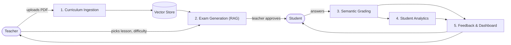

# Intelligent Educational Assessment System

An AI-powered system that helps teachers generate curriculum-based exams, grade open-ended answers semantically, and give students clear feedback on their performance.

> **Status:** In development. Curriculum ingestion and curriculum-grounded exam generation are implemented; the remaining modules are planned.

## Architecture



## Modules

| # | Module | What it does | Status |
|---|---|---|---|
| 1 | Curriculum Ingestion | Extracts text from PDFs, splits it into lessons and chunks, indexes it | Implemented |
| 2 | Exam Generation | Generates questions, model answers, and rubrics grounded in the curriculum | Implemented |
| 3 | Essay Grading | Grades answers by meaning against rubrics, with partial credit | Planned |
| 4 | Student Analytics | Predicts at-risk students and groups students by proficiency | Planned |
| 5 | Feedback & Dashboard | Student reports and a teacher dashboard | Planned |

## Project Structure

```text
├── data/
│   ├── raw/          # original PDFs and datasets
│   └── processed/    # cleaned and chunked data
├── outputs/          # generated exams, results, reports
├── scripts/          # reusable Python code (one file per module + config.py)
├── notebooks/        # experiments (one notebook per module)
├── .env.example
├── requirements.txt
└── README.md
```

## Getting Started

```bash
git clone <repository-url>
cd Intelligent-Educational-Assessment-System

python -m venv venv
# Windows: .\venv\Scripts\Activate.ps1
# macOS/Linux: source venv/bin/activate

pip install -r requirements.txt
cp .env.example .env    # Windows: Copy-Item .env.example .env
```

Create a Gemini API key in [Google AI Studio](https://aistudio.google.com/apikey)
and put it in the root `.env` as `GEMINI_API_KEY` (never commit this file).
The default configuration uses `LLM_PROVIDER=gemini` and
`LLM_MODEL_NAME=gemini-2.5-flash-lite`. The Gemini SDK sends only the
curriculum chunks selected by the existing local retrieval pipeline. Keep
`HF_EMBEDDING_MODEL_NAME` unchanged: it remains the local sentence-transformer
used to search the existing Chroma collection.

To make a single minimal chat request without generating an exam, run this in
the project environment:

```python
from scripts.generation import test_gemini_connection

print(test_gemini_connection())
```

The test makes one request and never prints the API key. If it reports an
authentication error, verify the key and that the Gemini API is enabled for
its Google AI Studio project. If it reports a quota or rate-limit error, check
the model limits and billing for that project.

Start Jupyter with `jupyter notebook`. If
`data/processed/curriculum_rag_store` does not exist yet, run
`notebooks/01_curriculum_ingestion.ipynb` once to create it; do not rerun
ingestion against an existing collection. Then run
`notebooks/02_exam_generation.ipynb`, which loads the collection without
rebuilding it and generates one question by default.
Choose a lesson to retrieve curriculum passages, generate and validate as many
questions as needed, and save the exam under `outputs/`. Each question
requires one model generation request. By default, questions are
balanced across MCQ, short-answer, and essay types. Each MCQ is scored as one
point for the correct selected option and zero otherwise. Generation validates
the score totals, question count, lesson assignment, and source quotations;
each source quote must occur in its cited curriculum chunk. If the model
paraphrases a source quote, generation retries that question once and still
rejects the question if the retry does not provide a verbatim citation.
Requests use a 4096-token output budget and retry once with an 8192-token
budget if the model returns an empty response.

## Workflow

We work notebook-first: experiment in `notebooks/`, then move stable code into `scripts/` and import it back into the notebooks.