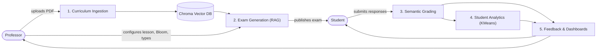

# Intelligent Educational Assessment System

An AI-powered system that helps teachers generate curriculum-based exams, grade open-ended answers semantically, and give students clear feedback on their performance.

> **Status:** Production-Ready Graduation Project. All five core modules (Ingestion, RAG Generation, Semantic Grading, Unsupervised ML Analytics, and Interactive Role-Based Dashboards) are implemented, hardened, and verified end-to-end.

## Architecture



## Modules

| # | Module | What it does | Status |
|---|---|---|---|
| 1 | Curriculum Ingestion | Extracts text from PDFs, splits into lessons and chunks, generates embeddings, indexes in Chroma DB (`data/processed/chroma_db`) | Implemented |
| 2 | Exam Generation | Generates questions, model answers, and rubrics grounded in curriculum context with verbatim source citations across Bloom's cognitive taxonomy | Implemented |
| 3 | Semantic Grading | Deterministic MCQ verification + LLM rubric-based criterion grading for open-ended answers with partial credit, strengths, and weaknesses | Implemented |
| 4 | Student Analytics | Unsupervised KMeans clustering (`outputs/student_cluster_pipeline.pkl`) grouping students into "Needs Intervention", "Proficient", and "Advanced" | Implemented |
| 5 | Feedback & Dashboards | Complete FastAPI REST API (`app/`) paired with modern React + Vite frontend (`frontend/`) featuring student and professor portals | Implemented |

## Project Structure

```text
├── app/                  # FastAPI web application (routers, auth, database, schemas)
│   ├── routers/          # auth, curriculum, exam, attempt, analytics routers
│   ├── auth.py           # JWT bearer authentication and role-based access control
│   ├── database.py       # SQLAlchemy engine and session dependency
│   ├── models.py         # User, Curriculum, Exam, ExamAttempt, StudentCluster models
│   └── schemas.py        # Pydantic v2 validation schemas
├── frontend/             # Modern React + Vite frontend with Tailwind CSS
│   ├── src/pages/        # Student & Professor portals, exam taking, analytics dashboards
│   └── src/components/   # Reusable UI component library (Card, Badge, Button, Alert)
├── data/
│   ├── raw/              # Curriculum textbook PDFs
│   └── processed/        # Chroma DB store (240 chunks across 14 ML lessons)
├── outputs/              # Benchmark comparisons, generated exams, trained model pickle
├── scripts/              # Reusable core modules (config, ingestion, generation, grading, analytics, feedback)
├── tests/                # Comprehensive unit and integration test suite
├── .env.example          # Environment configuration template
├── requirements.txt      # Python dependencies
└── README.md
```

## Getting Started

### 1. Backend Setup

```bash
git clone <repository-url>
cd Intelligent-Educational-Assessment-System

python -m venv .venv
# Windows: .\.venv\Scripts\Activate.ps1
# macOS/Linux: source .venv/bin/activate

pip install -r requirements.txt
cp .env.example .env    # Windows: Copy-Item .env.example .env
```

### 2. Supported LLM Providers (`LLM_PROVIDER` in `.env`)

- **Groq (Recommended for fast inference):** Set `LLM_PROVIDER=groq`, `GROQ_API_KEY=your_key`. Default model: `openai/gpt-oss-20b` (or `openai/gpt-oss-120b`). Handled via direct `httpx` with exponential backoff on HTTP 429 rate limits and client throttling.
- **Gemini:** Set `LLM_PROVIDER=gemini`, `GEMINI_API_KEY=your_key`. Default active model: `gemini-2.5-flash`.
- **Ollama:** Set `LLM_PROVIDER=ollama`, `OLLAMA_BASE_URL=http://localhost:11434`. Default model: `llama3.2`.

Test LLM connectivity at any time:
```bash
python -c "from scripts.generation import test_llm_connection; print(test_llm_connection())"
```

### 3. Run the Backend API

```bash
python -m uvicorn app.main:app --reload --port 8000
```
Interactive API documentation available at `http://127.0.0.1:8000/docs`.

### 4. Run the React Frontend

```bash
cd frontend
npm install
npm run dev
```
Access the application at `http://localhost:5173`.

### 5. Running Tests & Benchmarks

Run the test suite:
```bash
python -m unittest discover -v
```

Run model latency and accuracy benchmarks:
```bash
python scripts/benchmark_models.py --models groq:openai/gpt-oss-20b groq:openai/gpt-oss-120b gemini:gemini-2.5-flash
```

Retrain the unsupervised clustering model:
```bash
python scripts/train_clusters.py
```